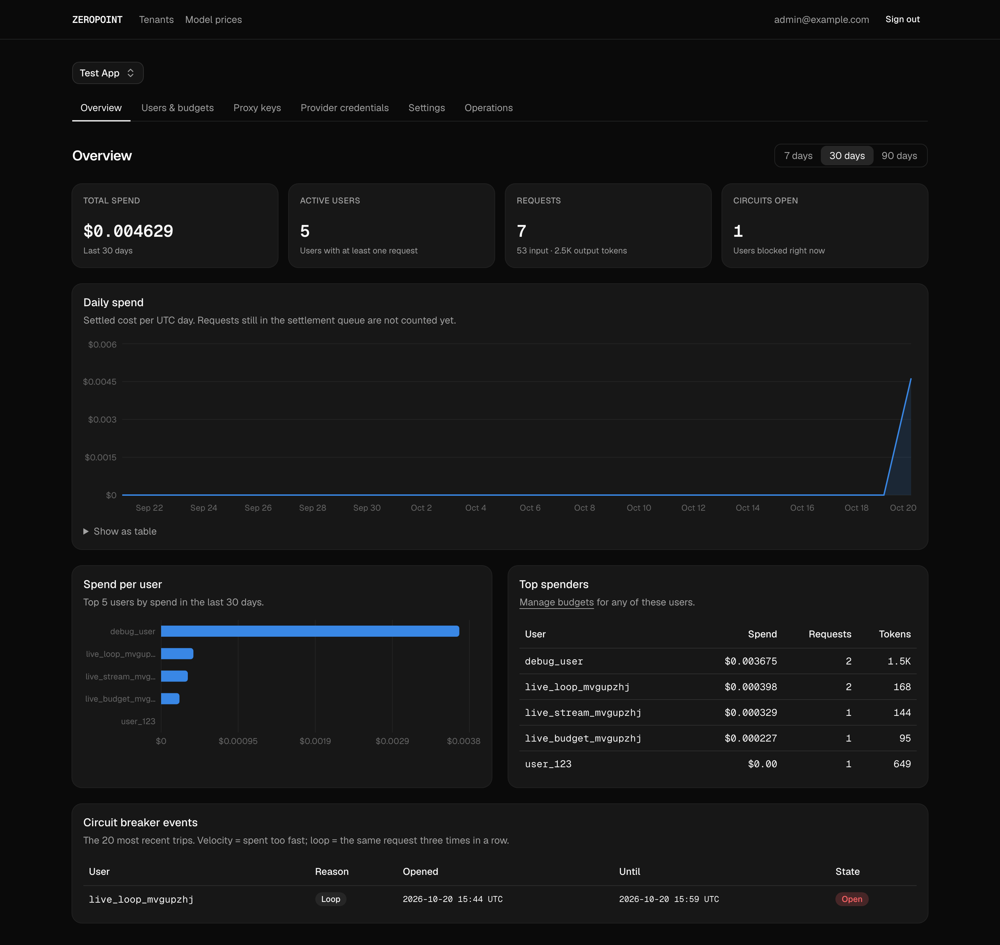
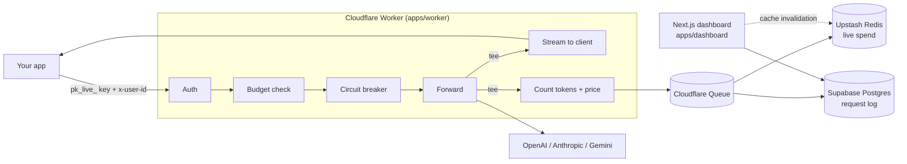
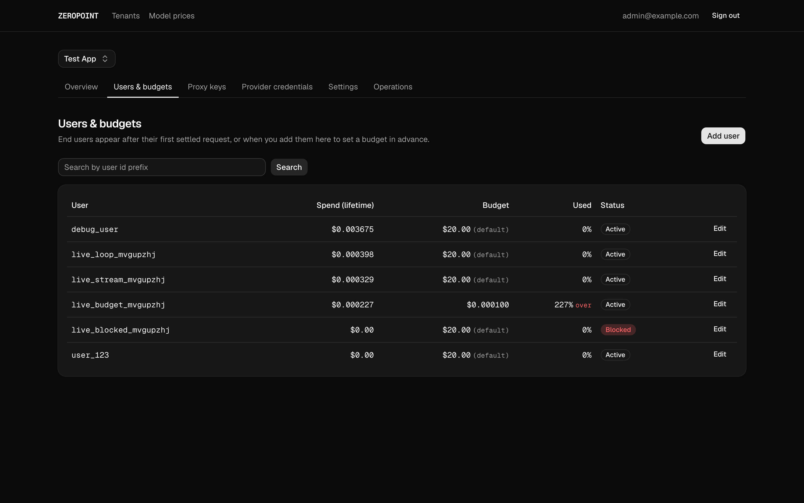
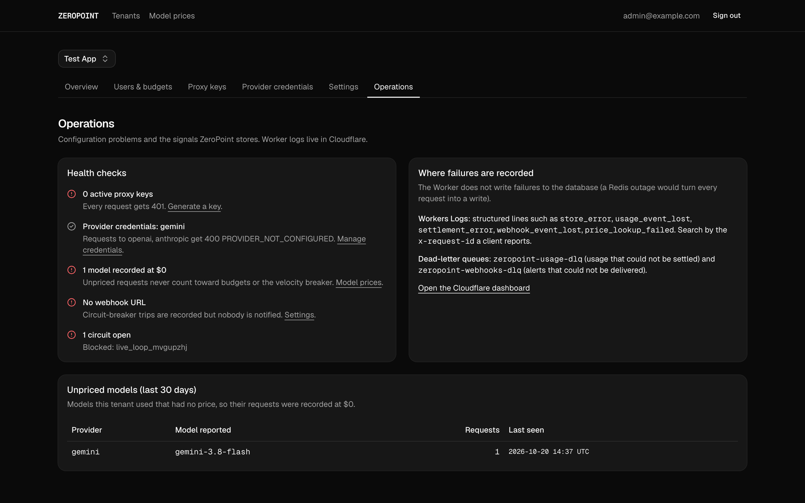
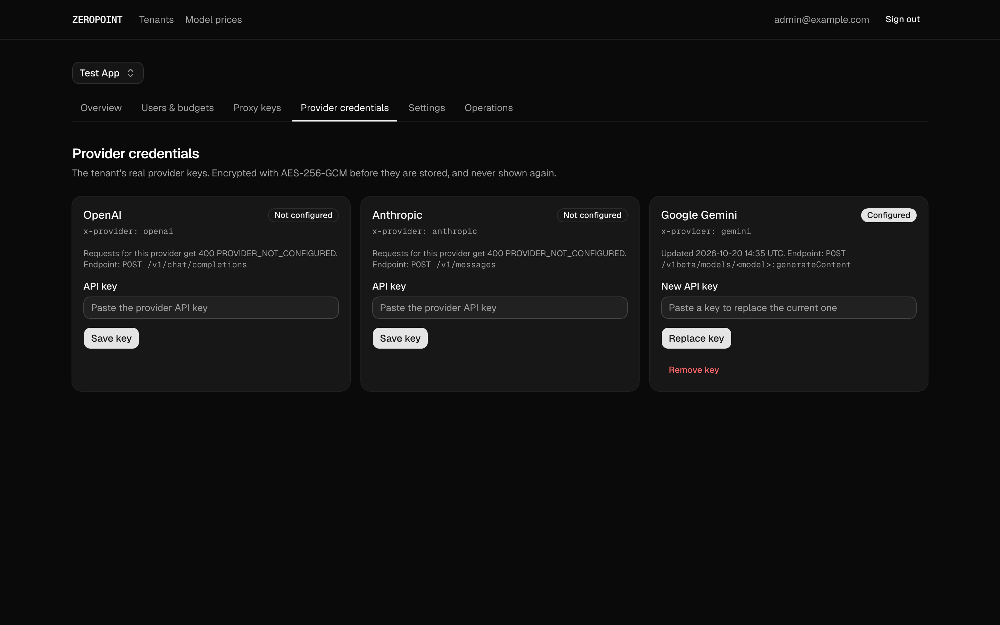
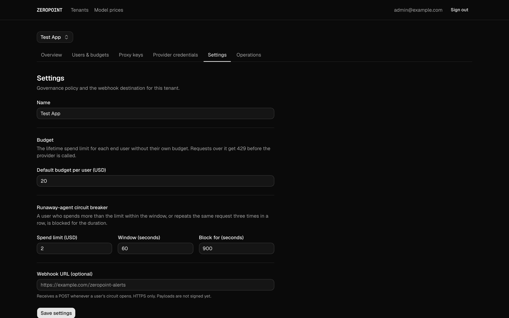
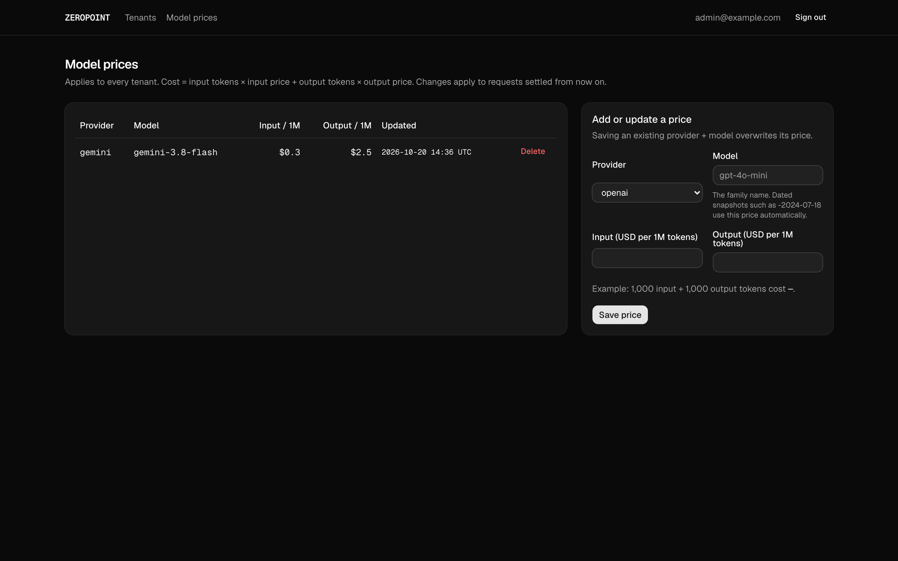

# ZeroPoint

**An edge AI gateway that stops runaway LLM spend before it happens.**

ZeroPoint sits between your app and OpenAI, Anthropic or Gemini. Every request is authenticated, checked against the user's budget and screened for runaway agent loops *before* the provider is called. Usage is then priced and recorded in the background, without slowing the response down.



## Why

One user's runaway agent loop, or one leaked key, can run up a large LLM bill before anyone notices. ZeroPoint gives each of your end users a budget, blocks an agent that repeats itself or spends too fast, and shows you where the money goes.

## Features

- **Pre-flight budget enforcement.** Each end user has a spend limit. A user over it gets `429 BUDGET_EXCEEDED` before the provider is called, so the blocked request costs nothing.
- **Runaway agent circuit breaker.** A user who spends more than $2 within 60 seconds, or sends the same request three times in a row, is blocked for 15 minutes. All three values can be set per tenant. The trip is recorded, and an optional webhook alert is sent.
- **Zero-lag streaming.** Responses are split with `tee()`: one copy streams straight to the client, while the other is read in the background to count tokens.
- **Accurate, idempotent settlement.** Usage goes through Cloudflare Queues into Redis (for live budget checks) and PostgreSQL (for history). A retried queue message is never charged twice.
- **Multi-provider.** OpenAI, Anthropic and Gemini, streaming and non-streaming, through one proxy key format.
- **Secure by default.** Proxy keys are shown once and only their SHA-256 hash is stored. Provider keys are encrypted with AES-256-GCM. Prompt and response text is never stored.
- **Admin dashboard.** Admins sign in by emailed link and manage tenants, keys, provider credentials, budgets and model prices, and see spend, token and circuit-breaker analytics.

## How it works



1. **Enforce:** check the key, the user's status, their budget and the circuit breaker. All of it happens on the Worker, using cached Redis data, before the provider is called.
2. **Observe:** forward the request and split the response. The client gets its stream untouched, and the second copy is read for token counts.
3. **Settle:** price the usage and queue it. The queue consumer adds it to the user's spend in Redis and Postgres, and each update counts a request at most once, even when a message is retried.

## Screenshots

| Users and budgets | Operations |
| --- | --- |
|  |  |
| **Provider credentials** | **Governance settings** |
|  |  |



## Tech stack

| Layer | Technology |
| --- | --- |
| Proxy | Cloudflare Workers (TypeScript), Cloudflare Queues |
| Hot state | Upstash Redis (REST API, atomic Lua scripts) |
| Database | Supabase PostgreSQL (row-level security, SQL functions) |
| Dashboard | Next.js 16, React 19, Tailwind CSS 4, shadcn/ui, Recharts, Supabase Auth |
| Tests | Vitest, PGlite (real Postgres in-process) |

## Project structure

```
apps/
  worker/          Cloudflare Worker: auth, budgets, circuit breaker, proxy, settlement
  dashboard/       Next.js admin dashboard
packages/
  crypto/          SHA-256 key hashing, AES-256-GCM credentials, proxy-key generation
  pricing/         Cost formula and model-price matching
  providers/       OpenAI, Anthropic and Gemini adapters
  schemas/         Cache keys and rules shared by the Worker and the dashboard
  types/           Shared types
database/migrations/   SQL migrations 001-007
docs/              SRS, phase plans and write-ups, changelog
tests/             Unit and integration tests
```

## Getting started

### Requirements
Node 20+, pnpm, and free accounts on [Supabase](https://supabase.com) and [Upstash](https://upstash.com). To send real requests you also need an API key from a provider. Google AI Studio offers a free Gemini key.

### Commands
```
pnpm install
pnpm check            # typecheck + lint + tests (Worker and dashboard)
pnpm test
pnpm build:check      # bundle the Worker without deploying
pnpm dev              # wrangler dev (needs apps/worker/.dev.vars)
pnpm dashboard        # next dev for the dashboard (needs apps/dashboard/.env.local)
pnpm dashboard:build  # production build of the dashboard
```

### Running locally
1. Create a Supabase project and apply `database/migrations/*.sql` in order (001-007) in the SQL editor.
2. Create an Upstash Redis database and copy its **REST** URL and token.
3. Generate one encryption key with `pnpm helper gen-encryption-key`. The Worker and the dashboard must use the same value.
4. Worker: `cp apps/worker/.dev.vars.example apps/worker/.dev.vars` and fill it in (git-ignored).
5. Dashboard: `cp apps/dashboard/.env.example apps/dashboard/.env.local` and fill it in (git-ignored).
6. Allow yourself into the dashboard: run the SQL printed by `pnpm helper add-admin you@company.com` in the Supabase SQL editor.
7. In Supabase Auth, set the Site URL to `http://localhost:3000` and add `http://localhost:3000/auth/callback` to the redirect URLs.
8. `pnpm dashboard`, then open http://localhost:3000 and sign in with the emailed link. Then:
   1. Create a tenant.
   2. Add a provider credential.
   3. Add model prices (spend stays at $0 until a model has a price).
   4. Generate a proxy key.
9. `pnpm dev` (local queues are simulated, so none need to be created), then:
```
curl -X POST "http://localhost:8787/v1beta/models/gemini-3.8-flash:generateContent" \
  -H "Authorization: Bearer pk_live_..." -H "x-user-id: user_123" -H "x-provider: gemini" \
  -H "Content-Type: application/json" -d '{"contents":[{"parts":[{"text":"hi"}]}]}'
```

| Provider | Endpoint | Header |
| --- | --- | --- |
| OpenAI | `POST /v1/chat/completions` | `x-provider: openai` |
| Anthropic | `POST /v1/messages` | `x-provider: anthropic` |
| Gemini | `POST /v1beta/models/<model>:generateContent` (or `:streamGenerateContent?alt=sse`) | `x-provider: gemini` |

All use `Authorization: Bearer <proxy key>` and `x-user-id: <your end user's id>`. The tenant needs a credential for each provider it uses. `GET /health` reports readiness (503 if secrets are missing). Every proxy response carries an `x-request-id` header; quote it when reporting a problem.

### Deploying
- **Worker (Cloudflare):** create the four queues once with `wrangler queues create`: `zeropoint-usage`, `zeropoint-usage-dlq`, `zeropoint-webhooks` and `zeropoint-webhooks-dlq`. Set the secrets from `.dev.vars.example` with `wrangler secret put`, then run `pnpm run deploy` (`pnpm deploy` alone is a different, built-in pnpm command).
- **Dashboard (Vercel):** create a Vercel project with **Root Directory** `apps/dashboard` (framework: Next.js). Set the variables from `apps/dashboard/.env.example`, including `DASHBOARD_URL`, and add `<DASHBOARD_URL>/auth/callback` to Supabase Auth's redirect URLs.

Never commit `.dev.vars`, `.env.local` or any real key.

## Testing

- **451 automated tests** (`pnpm test`) cover the Worker, the shared packages, the dashboard's validation and admin checks, and every SQL migration, which runs on a real in-process Postgres (PGlite).
- **Live run** against real Supabase, Upstash and Gemini. These all behaved as designed:
  - a blocked user got `403`
  - a user over budget got `429`, without the provider being called
  - three identical requests opened the circuit breaker
  - a streamed reply was priced
  - a revoked key got `401` immediately

## Status

All four phases of the [SRS](docs/ZeroPoint_SRS_v1.0.pdf) are built:

| Phase | What | Write-up |
| --- | --- | --- |
| 1 | Edge proxy and pre-flight budget guardrails | [PHASE_1.md](docs/PHASE_1.md) |
| 2 | Dual-stream parsing and async settlement | [PHASE_2.md](docs/PHASE_2.md) |
| 3 | Runaway agent loop circuit breaker | [PHASE_3.md](docs/PHASE_3.md) |
| 4 | Admin analytics dashboard | [PHASE_4.md](docs/PHASE_4.md) |

Every change and the reason for it is in [CHANGELOG.md](docs/CHANGELOG.md).

**Next up:**
- signed webhooks
- manually closing a circuit
- a half-open circuit state
- rebuilding Redis spend from Postgres
- multi-level budgets (per key, model and feature)
- a persisted log of operational failures

## License

[MIT](LICENSE) © 2026 Armaan Ali
